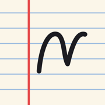
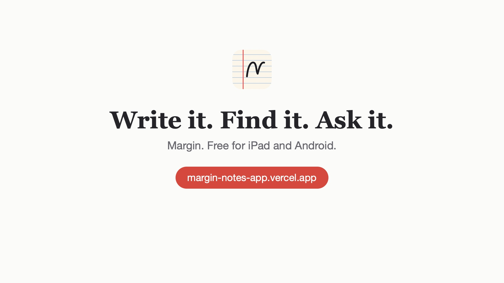
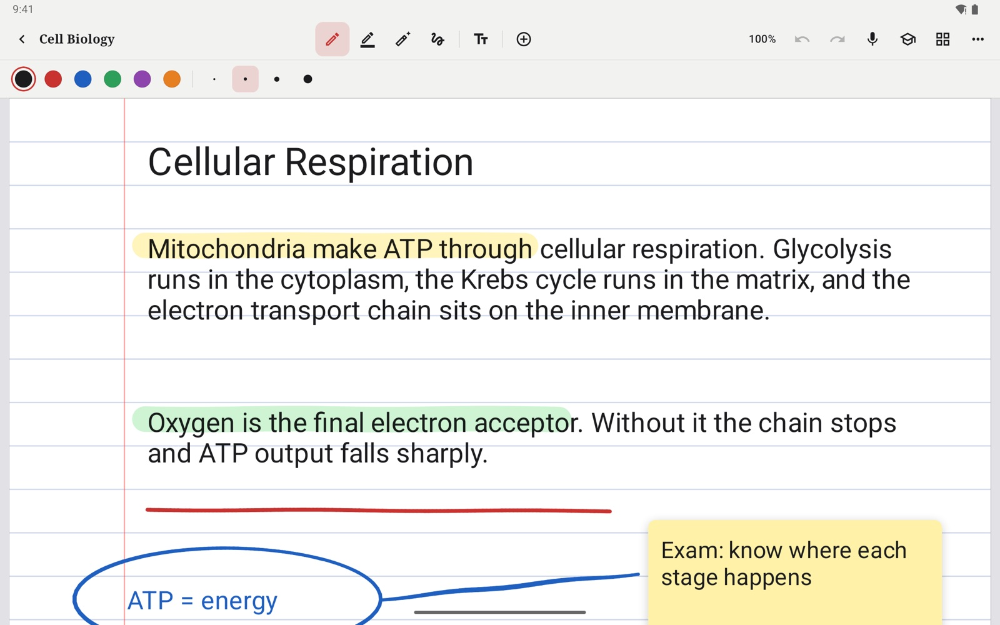
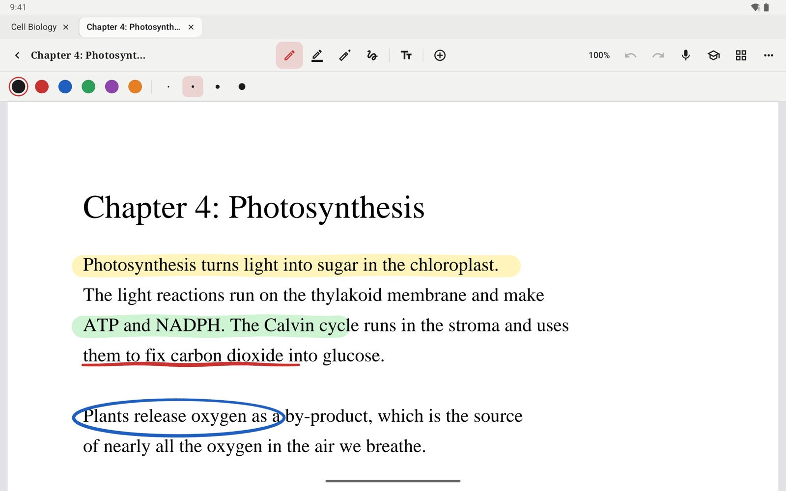
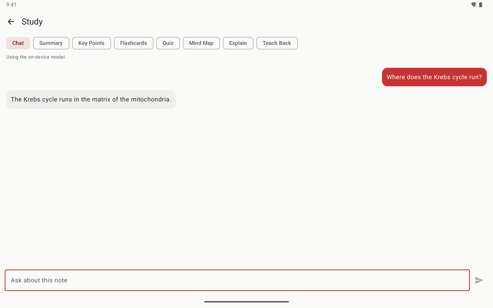

<p align="center"></p>

<h1 align="center">Margin</h1>

<p align="center"><b>Write it. Find it. Ask it.</b><br>A free note-taking and PDF annotation app for iPad and Android.</p>

<p align="center">
  <a href="https://github.com/warriorbiswas-tech/margin-app/releases/latest/download/Margin-Android.apk"><b>Download for Android</b></a> ·
  <a href="https://github.com/warriorbiswas-tech/margin-app/releases/latest/download/Margin-iPad.ipa"><b>Download for iPad</b></a> ·
  <a href="https://margin-notes-app.vercel.app">Website</a>
</p>

Margin is a notes app that feels like writing on paper: a stylus or finger, real pressure, highlighters, and PDFs you can mark up. It keeps your lectures, textbooks and meetings in one library you can search, including your handwriting. Then it answers questions from what you wrote, with an AI that can run entirely on your device, so nothing leaves it.

<p align="center"><a href="https://margin-notes-app.vercel.app"></a><br><sub><a href="assets/margin.mp4">Watch the 22-second tour</a></sub></p>

## What it does

- **Writes like paper.** Pressure and optional tilt shape the line, palm rejection lets your hand rest, scratch out to erase, and hold at the end of a stroke for a clean line, circle or box.
- **Marks up any PDF.** Highlight, underline and circle textbooks and slides, add sticky notes and stamps, and export it all as a PDF.
- **Answers from your notes.** Chat with a note, get summaries and key points, make flashcards with spaced review, quizzes and mind maps, or explain a topic and have Margin check you.
- **Private by default.** A 1.1 GB open-source model runs on your device. Add your own NVIDIA API key for a stronger online model, and Margin falls back to the device whenever it can't answer.
- **Stays organised.** Folders, tags, notebook covers, templates, tabs, and search across typed text, PDFs and handwriting. Record a lecture and tap what you wrote to hear that moment.

| Write | Mark up | Ask |
| --- | --- | --- |
|  |  |  |

## Install in a minute

**Android** (10 or later, 64-bit): download [Margin-Android.apk](https://github.com/warriorbiswas-tech/margin-app/releases/latest/download/Margin-Android.apk) on your device, open it, and allow your browser to install apps when asked. From a computer with `adb`:

```bash
curl -LO https://github.com/warriorbiswas-tech/margin-app/releases/latest/download/Margin-Android.apk && adb install Margin-Android.apk
```

**iPad** (iPadOS 17 or later): download [Margin-iPad.ipa](https://github.com/warriorbiswas-tech/margin-app/releases/latest/download/Margin-iPad.ipa) on a Mac or Windows PC and install it with [Sideloadly](https://sideloadly.io) or [AltStore](https://altstore.io), signing in with your Apple ID. Margin isn't on the App Store yet, and with a free Apple ID it has to be reinstalled every 7 days.

For offline AI on either, open **Settings** and download the writing model once.

## Sister app: Quirk Notes

[Quirk Notes](https://github.com/warriorbiswas-tech/Quirk-notes) is made by the same developer for the same job: free handwritten notes, PDF markup and AI study tools, with no account and no subscription. It also runs in any web browser with nothing to install. [Try Quirk Notes](https://quirk-notes.vercel.app/).

## Questions

**Is it free?** Yes. No account and no subscription.

**Where do my notes go?** They stay on your device, and in your own iCloud Drive folder or Google backup if you use one. With an NVIDIA key, your question and the notes it needs are sent to NVIDIA to answer it.

**Are the iPad and Android apps the same?** The core is: ink, PDFs, recording and the study tools. The iPad app is further along, with live transcripts, Live Text, iCloud sync, more paper styles, signatures and study tape. Notes don't move between the two yet.

**Found a bug or want a feature?** [Open an issue](https://github.com/warriorbiswas-tech/margin-app/issues).

---

Margin is made by [warriorbiswas-tech](https://github.com/warriorbiswas-tech). This repository hosts the releases and the website. Checksums for every download are in each release's `SHA256SUMS.txt`.
